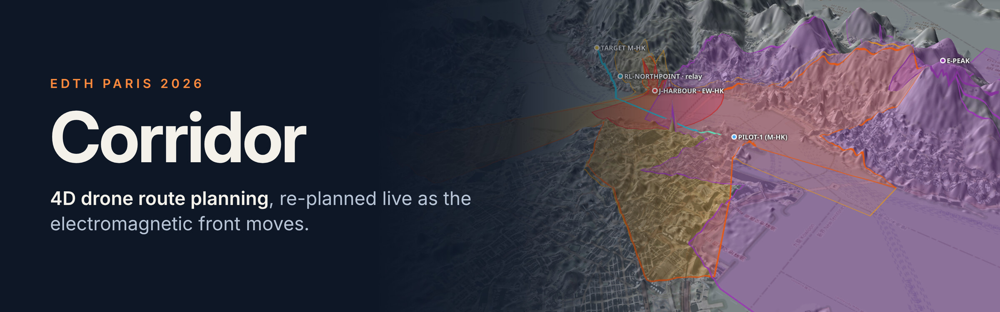
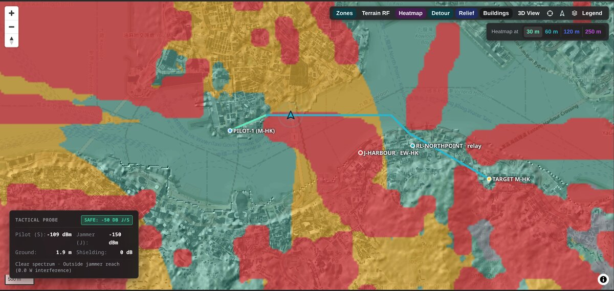
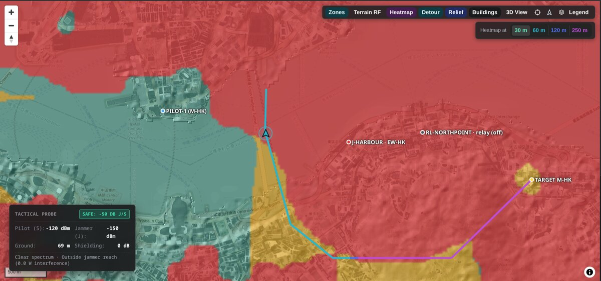

<p align="center"></p>

# Corridor

<!-- prettier-ignore -->
| | |
| --- | --- |
| CI/CD | [](https://github.com/Yoann-CORGNET/corridor/actions/workflows/ci.yml) [](.github/dependabot.yml) |
| Backend | [](https://www.python.org/) [](https://fastapi.tiangolo.com/) [](https://docs.pydantic.dev/) [](https://numpy.org/) |
| Frontend | [](https://react.dev/) [](https://www.typescriptlang.org/) [](https://vite.dev/) [](https://maplibre.org/) [](https://mantine.dev/) |
| TAK | [](https://github.com/brian7704/OpenTAKServer) [](docs/tak.md) [](docs/tak.md) |
| Meta | [](https://docs.astral.sh/uv/) [](https://docs.astral.sh/ruff/) [](https://mypy-lang.org/) [](https://oxc.rs/) [](https://www.conventionalcommits.org/) [](#corridor) |

Drone routes are planned before take-off, but the front changes during the flight: a new enemy
jammer goes up, a radar is reported. Friendly jammers add a problem of their own: they protect
units against enemy drones, but they also cut the links of friendly drones. Pilots work around
them with long detours, or by negotiating a corridor with the nearby unit over group chats.

Corridor is a 4D route planner (space and time). It computes the route that reaches the target
while avoiding radars and jamming zones and keeping the radio link with the pilot, then keeps
re-planning it until the drone is on target.

Built at the European Defense Tech Hackathon (EDTH) Paris 2026. Software only.

## What it does

- **Plans in space and time.** Timed route around radars and jamming zones, within the battery,
  with up to three options (fastest, one cut, safe) and the reason for each bend.
- **Re-plans in flight.** A new threat, a cancelled cut, a late drone or a relay switched off:
  the engine checks the rest of every flight every half second and re-plans from where the drone
  is.
- **Times the crossing on a friendly jammer cut.** When the fastest way runs through a friendly
  jammer, the pilot requests a cut in one click. The crossing is timed inside the cut window with
  safety margins, and the jammer restart time never moves.
- **Real terrain and antennas.** 3D zones per flight level (30 to 250 m) shaped by terrain and
  buildings, friendly relay antennas, directional jammers, a lost-link failsafe on every route.
- **One picture, filtered per role.** Command, pilot and jammer operator each get their own web
  view; the server filters what each role may see.
- **Built for ATAK.** No plugin: Corridor speaks CoT (Cursor on Target) to an OpenTAKServer that
  ATAK phones connect to.

Safety rules (EW protection first, no crossing on an unconfirmed cut, a human approves) and the
full behaviour: [`docs/feature.md`](docs/feature.md).

<table>
<tr>
<td></td>
<td></td>
</tr>
<tr>
<td align="center">Relay on: the route crosses the harbour.</td>
<td align="center">Relay switched off mid-flight: new route from the drone.</td>
</tr>
</table>

## Status

- Working: scenario loading, J/S jamming zones (2D and 3D), planner (SIPP over safe intervals,
  take-off sweep, smoothing, route reasons), cut requests and confirmations, simulated flights
  with the safety rule and fallback routes, relays, heatmap, WebSocket server with its JSON
  Schema, web front end with the three role views.
- TAK side: OTS stack, CoT client and demo shapes work on their own (sections below). The TAK
  adapter that publishes the engine's zones, routes and notifications to ATAK is not wired yet.
- Simulated: the drone flight (no autopilot link), threats entered by hand, jammer schedules
  entered in Corridor.

## Quick start

```bash
# terminal 1
cd backend
uv sync
uv run corridor-server --scenario scenarios/demo_passage_b.json
# terminal 2
cd frontend
npm install
npm run dev        # http://localhost:5173
```

Scenarios in `backend/scenarios/`: `demo_passage_a.json` (new threat mid-flight) and
`demo_passage_b.json` (crossing during a cut), both scripted in
[`docs/demo_script.md`](docs/demo_script.md); `hongkong.json` and `hongkong_relay.json` (3D,
buildings, relay); `demo.json`, `demo3d.json`, `directional.json`, `newyork.json`,
`annecy.json`.

## Architecture

```
web front end ◄──WebSocket /ws──► backend (Python, one process: FastAPI + uvicorn)
(planning screen)                   ├─ engine: world state, simulation clock, safety rules
                                    ├─ planner: pure computation, in a worker process
                                    ├─ WebSocket adapter: commands in, events out
                                    └─ TAK adapter (next) ◄──CoT, TCP 8088──► OpenTAKServer ◄──► ATAK (Android)
```

- The engine is the single owner of state: scenario, cuts, mission status, simulation time.
  Adapters only send it commands and receive its events. The web front end and ATAK are two
  views of it.
- Planner: pure function (no state, no clock), run in a worker process. J/S jamming model and
  planner design in [docs/architecture.md](docs/architecture.md).
- TAK adapter: will publish zones, routes, drone and notifications as CoT, and turn ATAK chat
  (`ACK`) into commands. The CoT client (`corridor.tak`) works standalone.
- No ATAK plugin: access to the official TAK SDK is restricted, so Corridor runs as an external
  service. OTS is only the relay to ATAK; the web front end never talks to OTS directly.

Core architecture, module layout and WebSocket protocol: [docs/architecture.md](docs/architecture.md).

## Repository layout

```
backend/    Python project (uv): engine, WebSocket server, TAK client, tests, scenarios
schema/     WebSocket protocol JSON Schema, generated by the backend, consumed by the front end
infra/ots/  OpenTAKServer stack (Docker compose)
docs/       architecture.md (core, protocol, planner design), feature.md (functional spec),
            demo_script.md (timed demo runs), assets/ (README images)
resources/  research notes, standalone planner prototype, old state of the art (reference only)
frontend/   front end (React + Vite)
```

## Documentation

- [`docs/feature.md`](docs/feature.md): users, behaviour, safety rules, open questions.
- [`docs/architecture.md`](docs/architecture.md): engine, planner, jamming model, WebSocket protocol.
- [`docs/demo_script.md`](docs/demo_script.md): the timed demo runs.
- [`docs/tak.md`](docs/tak.md): OpenTAKServer, CoT client, connecting ATAK.
- [`CONTRIBUTING.md`](CONTRIBUTING.md): requirements, server options, checks, CI.
- [`frontend/README.md`](frontend/README.md): front end stack, rules and layout.
